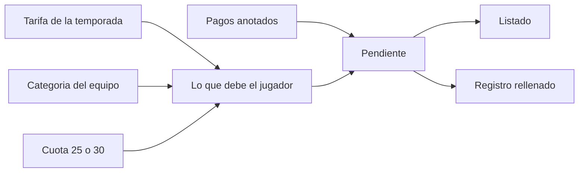

# Tarifas por temporada y listado de pendientes

El corte es solo esto: configurar la tarifa, ver qué le falta a cada jugador y anotar el cobro con el formulario ya relleno. El resumen del club sigue con datos de ejemplo. Control económico queda para cuando esa tarifa ya esté en uso.

## Cómo queda el cobro

Tres audiencias, no una fila por cada categoría del club. La categoría del equipo decide la audiencia: minivoley–júnior es base, sénior y aficionados van aparte. Un jugador sin equipo no genera cuotas.

La tarifa de la temporada actual se siembra así, y desde `/admin/pagos/tarifas` se puede cambiar importe, meses o añadir otra línea sin tocar código:

- **Base:** matrícula (75 €, el importe del catálogo actual), equipación (sin importe hasta que lo guardéis; mientras esté vacía no genera deuda) y mensualidad de octubre a junio, 25 € o 30 € según `players.pays_extended_monthly`.
- **Sénior:** matrícula, pago único de 90 € (cubre hasta diciembre, es un solo cobro) y mensualidad de 25 € en enero, febrero y marzo.
- **Aficionados:** matrícula y pago único de 90 €. Sin mensualidad.

Las deudas no se insertan en `payments`. Esa tabla es compartida con Team Manager y el portal solo anota cobros ya recibidos (`status = paid`). Lo pendiente se calcula: tarifa del jugador menos la suma de lo anotado.

Un mes se considera vencido cuando el calendario ya está en ese mes o en uno posterior de la temporada (octubre–junio). Los meses que aún no llegan salen igual, en tono neutro, para poder anticipar el informe. Matrícula, equipación y pago único cuentan como vencidos desde el inicio de temporada.

Si pagan una parte, el mes o el concepto sigue abierto por la diferencia. El siguiente registro propone ese resto y el importe se puede cambiar. Varios cobros del mismo concepto y mes se suman.

## Datos

Migración nueva, aditiva:

- Tabla propia `season_fee_lines`: `season`, `audience` (`base` | `senior` | `aficionados`), `code`, `label`, `kind` (`once` | `monthly`), `amount` (nullable hasta guardar equipación), `amount_extended` (solo la mensualidad de base), `months` (1–12). Unique `(season, audience, code)`.
- En `payments`, dos columnas nullable que Team Manager puede ignorar: `fee_code` y `billing_month`. El texto `concept` se sigue escribiendo (p. ej. `Cuota mensual — octubre`) para no romper lecturas ajenas.
- RLS de admin/manager **y** `GRANT` a `authenticated` en la misma migración. Sin el grant, la policy no basta: ya pasó con [`payment_concepts`](supabase/migrations/20261001110000_payment_concepts_grants.sql).

Backfill de cobros ya existentes por el texto del concepto: matrícula y pago único reciben `fee_code`. Una `Cuota mensual` antigua no tiene mes, así que no cierra octubre ni ningún otro; en el listado se ve como cobro sin mes. No se adivina el mes.

[`payment_concepts`](supabase/migrations/20261001100000_payment_concepts.sql) se deja en base de datos. Deja de alimentar el formulario. `/admin/pagos/conceptos` redirige a tarifas.

## Pantallas

**Tarifas** en [`app/(dashboard)/admin/pagos/tarifas/page.tsx`](app/(dashboard)/admin/pagos/tarifas/page.tsx), enlazada desde el listado en el sitio del enlace actual a predefinidos. Selector de temporada (por defecto la actual, vía [`lib/season.ts`](lib/season.ts)) y tres bloques editables. Botón para copiar la temporada anterior cuando la elegida está vacía. Cache igual que [`lib/payments/cached-concepts.ts`](lib/payments/cached-concepts.ts): `'use cache'` + tag, sin cookies.

**Listado** en [`components/payments/PlayersPaymentsPageClient.tsx`](components/payments/PlayersPaymentsPageClient.tsx). La columna de matrícula pasa a ser “Pendiente”: matrícula, equipación y pago único como etiquetas, y los meses agrupados (`Oct–Jun · 9`, o los que queden). “Al día” si no falta nada. “Sin categoría” si no hay equipo. Filtro de solo pendientes y búsqueda se mantienen. El registro en bloque también.

**Drawer de un jugador.** El único campo que hay que elegir es qué se cobra: cada mensualidad abierta es un mes. Concepto, fecha de hoy y método (transferencia) vienen puestos. El importe es el resto y se puede cambiar: bajarlo deja el concepto abierto por la diferencia; subirlo se guarda tal cual en el cobro. El saldo a favor, el filtro de “a quién debemos” y aplicarlo al siguiente pago no entran aquí. Sigue existiendo “Otro” para un cobro que no cierra ninguna línea de la tarifa.

**Drawer en bloque.** Se elige la línea y, si es mensual, el mes. Por defecto cada jugador lleva su propio resto (25 o 30, o lo que quede de un pago parcial). Quien ya lo tenga cubierto se salta. Hay un importe único opcional por si el mismo día se anota la misma cantidad a todos.

La lógica de “qué debe” y “cuánto queda” vive en funciones puras (`lib/payments/fees.ts`) con tests: audiencias, meses de base/sénior/aficionados, 25 contra 30, pago parcial, cobro antiguo sin mes, y mes vencido contra mes futuro con una fecha fija.

## Fuera de este corte

Apuntado el 2026-10-13 en [Tareas pendientes](https://app.notion.com/p/3edd2def504c815a82b2c8edf1cc0d9f), sección «Portal — pendiente 2026-10-13»:

- Control económico (cobrado, pendiente, morosos).
- Pantalla de inicio: sustituir los datos de ejemplo de pagos por el cálculo real.
- Saldo a favor: filtrar a quién debe el club por un cobro de más y aplicar el sobrante al siguiente pago. En este corte el importe superior solo se anota.
- Mejorar el filtro de jugadores.
- Revisar por qué la lista de jugadores va lenta.
